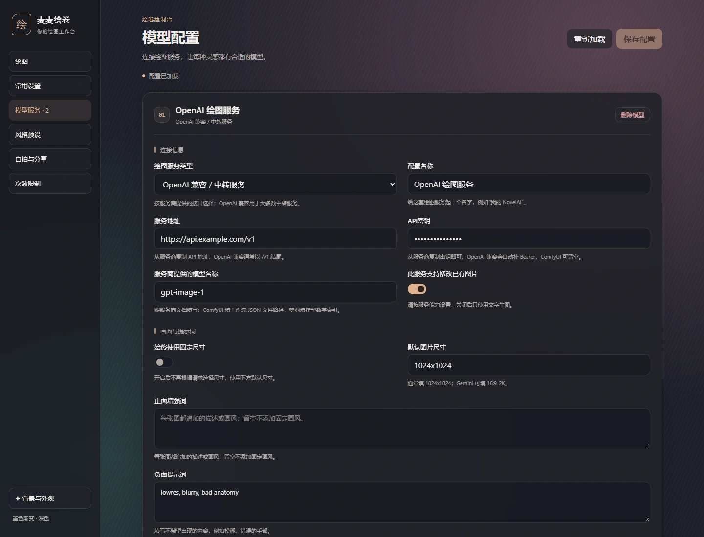
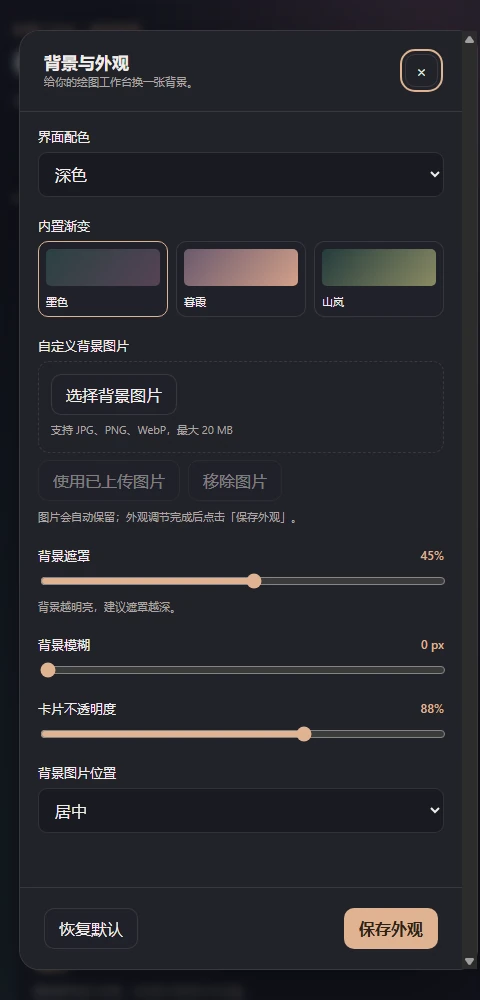

<p align="center">
  
</p>

<h1 align="center">麦麦绘卷</h1>

<p align="center">
  <strong>让麦麦帮你画图、改图、拍自拍</strong><br>
  <sub>Claude MAInet · MaiBot 多模型绘图插件</sub>
</p>

<p align="center">
  
</p>

<p align="center">
  <a href="#quick-start">快速开始</a> ·
  <a href="#page-guide">页面与背景</a> ·
  <a href="#commands">常用命令</a> ·
  <a href="#advanced">进阶配置</a> ·
  <a href="#developer-api">开发接口</a>
</p>

<p align="center">
  <a href="docs/images/control-console.webp"></a>
</p>

<p align="center"><sub>绘图与配置集中管理 · 点击图片查看大图</sub></p>

支持 OpenAI 兼容服务、NovelAI、Gemini、豆包、百炼、ComfyUI 等接口，可配合 MaiTrace 自动自拍与主动分享。

<a name="quick-start"></a>

## 快速开始

### 1. 安装插件

在 **MaiBot 根目录**执行：

```shell
git clone https://github.com/ptrel1/mais_art_journal.git plugins/mais_art_journal
```

按系统选择一项安装依赖：

<details>
<summary><strong>Windows</strong></summary>

```shell
uv pip install --python .venv/Scripts/python.exe -r plugins/mais_art_journal/requirements.txt
```

</details>

<details>
<summary><strong>Linux / macOS</strong></summary>

```shell
uv pip install --python .venv/bin/python -r plugins/mais_art_journal/requirements.txt
```

</details>

依赖安装到 MaiBot 使用的 Python 环境；其他环境请替换 `--python` 路径。重启 MaiBot 后自动生成 `plugins/mais_art_journal/config.toml`。豆包另需 Ark SDK，见依赖说明。

### 2. 启用并配置模型

在插件设置的「开始使用」中 **启用插件并保存**，打开侧栏「绘卷控制台」→「模型服务」，添加或修改模型的服务类型、地址、密钥和型号。

选择 **默认文生图模型** 和 **命令画图使用的模型**，只有一个模型时都选它；图生图默认可沿用文生图模型。点击「保存配置」。

**提示词优化器** 建议保持开启，调整方法见[辅助 LLM 配置](#aux-llm)。

### 3. 试着画一张

```text
/dr 画一只猫
```

本文使用默认前缀 `/dr`。修改前缀或智能生图 Tool 开关后需重载插件。

<a name="page-guide"></a>

## 页面与背景

| 页面 | 用途 |
| --- | --- |
| 原生插件设置 | 插件开关与完整配置表单 |
| 侧栏「绘卷控制台」 | 页面绘图、配置管理与自定义背景；按接口格式显示模型字段 |

修改配置后点击「保存配置」；切换分区时，未保存的修改会保留。

### 在页面里绘图

保存模型配置后，在「绘图」中选择模型、填写描述，点击「开始绘图」。支持尺寸、负面提示词、角色自拍和参考图强度；模型开启固定尺寸时优先使用固定值。

参考图支持 JPG / PNG / WebP，最大 20 MB，长边自动缩至 2048 像素以内。结果保留原图，最大 32 MB，点击可放大。每个插件同时只运行一项后台任务，刷新后可继续查看；重载插件会清空任务和参考图。

页面绘图消耗服务商额度，不发送到聊天、不扣聊天次数、不使用缓存。「停止等待」结束本地处理，服务商已开始的任务仍可能计费。

### 换一张背景图片

打开「背景与外观」（手机端「外观」），选择渐变或上传 **JPG / PNG / WebP，最大 20 MB**，调整遮罩、模糊和图片位置后点击「保存外观」。

图片上传后自动保留，其他外观调节需保存；配置参数另用「保存配置」。外观存于 `data/webui/`，换浏览器仍保留。「恢复默认」保留上传图片，「移除图片」才会删除。

<details>
<summary><strong>查看背景设置面板</strong></summary>

<p align="center">
  <a href="docs/images/appearance-panel.webp"></a>
</p>

</details>

<details>
<summary><strong>模型名称、编号与默认模型的区别</strong></summary>

| 字段 | 怎么填写 |
| --- | --- |
| 配置名称 `name` | 显示名称，例如「我的 NovelAI」 |
| 配置编号 `id` | 插件内唯一编号，例如 `model1`；添加时可自动分配 |
| 服务类型 `format` | 服务商 API 协议，与型号分别设置 |
| 服务商型号 `model` | 按服务商文档填写；ComfyUI 填工作流路径，梦羽填数字索引 |

控制台按名称选择默认模型；原生页面 / TOML 填 **配置编号**。文生图、图生图和命令模型分别设置，命令模型不会自动跟随文生图默认值。切换服务类型时，隐藏字段的值仍保留。

</details>

<details>
<summary><strong>找不到页面或保存失败时</strong></summary>

| 现象 | 怎么处理 |
| --- | --- |
| 侧栏没有控制台 | 启用插件并保存，再刷新 WebUI |
| 选择格式后仍显示所有字段 | 原生表单显示全部字段，按格式隐藏仅在控制台生效 |
| 外观调节刷新后还原 | 调节后点击「保存外观」 |
| 删除无反应、样式或分区顺序仍旧 | 重载插件，再点击 MaiBot 外层「重载页面」；删除后仍需保存配置 |
| 提示配置已在其他页面修改 | 点击「重新加载」，读取最新配置后再编辑 |

控制台需宿主支持 `custom_pages`，背景上传需 `image_upload`；不支持时使用原生表单或 `config.toml`。绘卷内部「重新加载」只更新配置，宿主没有「重载页面」时可重载插件并刷新页面。

</details>

<a name="commands"></a>

## 常用命令

| 命令 | 用途 |
| --- | --- |
| `/dr 画一只猫` | 根据描述生成图片，附图时自动判断图生图 |
| `/dr 用model2画一只猫` | 指定模型，也支持「用模型二」等写法 |
| `/dr <风格名>` | 对图片应用预设风格 |
| `/dr list` | 查看可用模型 |
| `/dr styles` | 查看可用风格 |
| `/dr help` | 查看帮助 |

画图与改图也支持自然语言：

| 场景 | 示例 |
| --- | --- |
| 文生图 | `麦麦，画一只猫` |
| 改图 | 附图或回复图片：`麦麦，把背景换成海滩`，也可加 `/dr` 前缀 |
| 自拍 | `麦麦，来张自拍` |
| 风格转换 | 附图或回复图片：`/dr cartoon`（需已配置该风格） |

智能生图默认每条用户请求最多调用一次，可在「聊天与命令画图」设置 **每次用户请求最多生图几次**，0 表示不限制次数。触发 ID 必须是当前聊天最新的真实用户消息；达到上限后需等待用户新消息，不按时间窗口自动恢复。次数记录在插件重载或重启后保留，仅限制智能生图，`/dr`、主动分享和对外 API 沿用各自规则。

明确尚未进入生图客户端且未投递图片的失败会退回本次调用名额；进入客户端后的超时、下载或发送失败仍占次数，因为服务商可能已经计费。成功发送缓存图片也占一次。此限制按用户消息计算，与宿主的回复轮次及群／私聊周期额度分别生效。

角色自拍会保留明确的取景要求：全身、下半身、腿部和脚部取景使用合适的第三人称视角；全身对镜照需场景中确有全身镜。即使默认固定为前置自拍，也会为这些要求调整拍摄方式；仅提到裤子、袜子等服装不改变默认景别。

前置自拍中手机与持机手应在画面外，对镜自拍才显示反射中的手机。局部取景明确指定裁切范围，并只保留画面内可见的角色特征；参考图用于保持角色设计，不要求复制原图构图。豆包的负面要求会写入实际提示词。模型仍可能偏离指令，建议测试人物与局部构图时使用竖图，并确认模型的固定尺寸没有覆盖页面所选尺寸。

动作遵守最终景别：穿长袜的普通自拍不会为了展示服装而加入腿部动作，服装设置仍保留。角色照片只使用指定地点的普通场景物品，第三人称视点不要求加入摄影师、围观者或摄影器材，也不沿用参考图中的额外人物和背景。

<details>
<summary><strong>管理命令与权限</strong></summary>

在「可以管理绘卷的用户」中填写实际用户 ID 才能使用管理命令。官方 QQ 的 ID 规则见适配器说明。

| 命令 | 说明 |
|------|------|
| `/dr style <名>` | 查看风格详情 |
| `/dr config` | 显示当前聊天流配置 |
| `/dr set <模型ID>` | 设置 /dr 命令使用的模型 |
| `/dr default <模型ID>` | 设置智能生图 Tool 默认模型（当前聊天流，优先于场景自动选择） |
| `/dr model on\|off <模型ID>` | 开关指定模型 |
| `/dr recall on\|off <模型ID>` | 开关指定模型的撤回 |
| `/dr on` / `/dr off` | 开关插件（当前聊天流） |
| `/dr selfie on\|off` | 开关自拍日程增强（当前聊天流） |
| `/dr selfie auto\|standard\|mirror\|photo` | 切换自拍风格（当前聊天流） |
| `/dr reset` | 重置当前聊天流的所有运行时配置 |

> 设置按当前聊天流保存，重启后有效；未覆盖的选项跟随全局配置。`/dr reset` 清除当前聊天覆盖，不重置额度。

</details>

<details>
<summary><strong>额度查询与待核对记录</strong></summary>

| 命令 | 说明 |
|------|------|
| `/dr quota` 或 `/dr 额度` | 查看当前群共享额度或私聊个人额度 |
| `/dr quota adjust +5 [原因]` | 管理员增加本周期额度；负数为减少 |
| `/dr quota pending [页码]` | 管理员查看投递结果待核对的记录 |
| `/dr quota resolve <记录ID> sent [原因]` | 管理员确认这张图已经送达 |
| `/dr quota resolve <记录ID> refund [原因]` | 管理员确认未送达并退回原周期额度 |

额度默认关闭。启用后，用户发起的聊天生图共用额度：群内共享、私聊按用户计算；成功发送一张计一次，缓存图片和管理员也计数。

</details>

<a name="advanced"></a>

## 进阶配置

按所用服务展开配置示例。手动编辑时修改已有配置段；新增模型才追加 `[[models.items]]`，`id` 不可重复。

<details>
<summary><strong>支持的服务与接口格式</strong></summary>

按服务商文档选择接口协议和支持的生图型号。

| format | 平台 | 说明 |
|--------|------|------|
| `openai` | OpenAI / 硅基流动 / Grok / NewAPI 等 | 通用 `/images/generations` 接口 |
| `openai-chat` | 支持生图的 Chat 模型 | 通过 `/chat/completions` 生图，多策略提取图片 |
| `doubao` | 豆包（火山引擎） | 使用 Ark SDK，支持 seed/guidance_scale/watermark |
| `gemini` | Google Gemini | 原生 `generateContent` 接口，使用支持图片生成的 Gemini 模型 |
| `modelscope` | 魔搭社区 | 异步任务模式，自动轮询结果 |
| `dashscope` | 阿里百炼 DashScope | 支持通义千问/万相/Z-Image/可灵等模型 |
| `shatangyun` | 砂糖云 (NovelAI) | GET 请求，URL 参数传递 |
| `novelai` | 原生 NovelAI / YesNovelAI 等中转 | 官方 `/ai/generate-image` 或 JSON `/v1/nai/generate-image`，由 `novelai_api_mode` 选择 |
| `mengyuai` | 梦羽 AI | 支持图生图（默认走 Qwen Image Edit，可通过 `img2img_model_index` 切换） |
| `comfyui` | 本地 ComfyUI | 加载工作流 JSON，替换占位符，轮询结果（支持代理配置） |

</details>

<details>
<summary><strong>通用设置：提示词优化、缓存、重试与超时</strong></summary>

```toml
[plugin]
enabled = true                    # 启用插件
config_version = "4.6.8"          # 插件配置版本，自动维护，请勿改

[basic]
command_prefix = "/dr"            # 须以 / 开头
max_draws_per_request = 1         # 每条最新用户消息的智能生图调用上限；0 不限制次数
default_txt2img_model = "model1"  # 默认文生图模型 ID
default_img2img_model = ""        # 留空沿用文生图模型
enable_unified_generation = true  # 启用智能生图 Tool（draw_picture）
enable_pic_command = true         # 启用 /dr 图片生成命令
pic_command_model = "model1"      # /dr 命令默认模型
admin_users = ["12345"]           # 管理员实际用户 ID
max_retries = 2                   # API 失败重试次数
enable_debug_info = false         # 在聊天中显示生成进度
enable_verbose_debug = false      # OpenAI/OpenAI-Chat/DashScope 详细日志
cache_enabled = true              # 启用结果缓存
cache_max_size = 10               # 文生图 / 图生图各自的缓存上限，重启清空
auto_recall_enabled = false       # 还需模型 auto_recall_delay > 0
prompt_optimizer_enabled = true   # 普通图与自拍场景优化
llm_task_name = "utils"           # MaiBot 已配置的文本任务名
llm_timeout_seconds = 45          # 单次辅助 LLM 超时（秒）
generation_timeout_seconds = 170 # 普通后端生成总超时，最高 600 秒
proactive_min_energy = 30         # 主动发图最低精力（0–100）
```

相同参数可复用缓存结果；撤回还需配置模型延时，见 QQ 适配器说明。插件 `[proxy]` 控制图片请求；OpenAI / OpenAI-Chat 请使用 HTTP / HTTPS 代理，当前客户端不支持 SOCKS5。

</details>

<details>
<summary><strong>模型参数与 OpenAI 兼容示例</strong></summary>

硅基流动文生图示例，`model` 请替换为账号可用的生图型号：

```toml
[[models.items]]
id = "model1"                    # 插件内唯一 ID
name = "硅基流动文生图"            # 显示名称
format = "openai"
base_url = "https://api.siliconflow.cn/v1"
api_key = "YOUR_API_KEY_HERE"
model = "Kwai-Kolors/Kolors"
fixed_size_enabled = true
default_size = "1024x1024"
seed = -1                        # 随机种子
guidance_scale = 2.5
num_inference_steps = 20
custom_prompt_add = ""           # 留空表示不追加固定画风
negative_prompt_add = "lowres, bad anatomy"
prompt_syntax = "tags"           # 扩散模型使用标签语法
support_img2img = false          # 此例仅文生图
auto_recall_delay = 0            # 0 不撤回
```

`basic`、`selfie`、`group_image` 中的模型选择字段均引用本地 `id`。

| 参数 | 填写说明 |
| --- | --- |
| `base_url` | OpenAI / OpenAI-Chat 通常带 `/v1`；Gemini、DashScope 填服务根地址 |
| `api_key` | OpenAI / OpenAI-Chat 自动给裸 token 补 `Bearer`，已有认证方案原样保留；其他云后端支持裸 token 或 `Bearer token`，ComfyUI 可留空 |
| `fixed_size_enabled` / `default_size` | 开启时固定尺寸；关闭时按「请求尺寸 → LLM 选择 → 默认值」选择，须符合服务要求 |
| `guidance_scale` / `num_inference_steps` | 引导强度 / 步数，OpenAI 兼容接口可填 `-1` 省略。NovelAI 步数 1–50，引导强度官方 0.1–20、JSON 0–10 |
| `watermark` | 豆包、DashScope、OpenAI 格式的火山方舟使用；无法去除强制水印 |
| `custom_prompt_add` / `negative_prompt_add` | 共用正面增强词 / 负面词。正面词直接拼接，建议带逗号或空格；负面词按后端能力处理 |
| `prompt_syntax` | `auto` 自动选择自然语言或标签；`natural` / `tags` 手动指定 |
| `support_img2img` | 服务须实际支持图生图；设为 `false` 时丢弃源图，用同一模型文生图 |
| `selfie_reference_strength` | 自拍参考图强度，默认 0.6，用于 NovelAI、ComfyUI、标签语法的 OpenAI 扩散网关；请求中的 `strength` 优先 |

后端专用字段：

| 后端 | 专用配置 |
| --- | --- |
| `shatangyun` | `artist`、`cfg`、`sampler`、`noise_schedule`、`nocache`（仅服务端缓存）；只支持文生图，设 `support_img2img = false` |
| `mengyuai` | `model` 填数字字符串，如 `"0"`；`img2img_model_index` 默认 19；`image_upload_url` 上传参考图，留空尝试 data URI |
| `dashscope` | `endpoint_path`：万相 2.5 图生图用 `/api/v1/services/aigc/image2image/image-synthesis`，可灵用 `/api/v1/services/aigc/image-generation/generation`，两者自动异步；其他端点用 `dashscope_async` 控制，`prompt_extend` 控制扩写 |

</details>

<details>
<summary><strong>NovelAI：官方接口与 JSON 中转</strong></summary>

NAI 专属参数与通用参数写在同一模型项中；旧版嵌套配置会自动迁移。

```toml
[[models.items]]
id = "model2"
name = "NovelAI V4.5"
format = "novelai"
base_url = "https://image.novelai.net"
api_key = "YOUR_API_KEY_HERE"
model = "nai-diffusion-4-5-full"
fixed_size_enabled = true
default_size = "832x1216"
num_inference_steps = 28
guidance_scale = 5.0
custom_prompt_add = ""
negative_prompt_add = "lowres, bad anatomy, bad hands"
support_img2img = true

novelai_api_mode = "official"     # official / json；YesNovelAI 用 json
novelai_mode = "anime"            # anime / furry；background 仅 V4.5/V5
novelai_quality_tags = true
novelai_smea = false              # SMEA 仅支持 V3 文生图
novelai_smea_dynamic = false      # 开启时还需 novelai_smea = true
novelai_img2img_strength = 0.6     # 普通图生图强度；自拍用 selfie_reference_strength
novelai_img2img_noise = 0.1
novelai_request_timeout_seconds = 120
```

宽高须为 64–2048 的 64 倍数。支持 `nai-diffusion-3`、`nai-diffusion-furry-3`、`nai-diffusion-4-full`、`nai-diffusion-4-curated-preview`，以及 V4.5 / V5 的 Full 与 Curated 型号。V3 模式须与型号对应，V4+ 通过标签切换。

接入 [YesNovelAI](https://nai.rinko.ai/docs)：将 `novelai_api_mode` 改为 `"json"`，地址填 `https://nai.rinko.ai`，密钥填 `ynai-你的令牌`。也接受带 `/v1` 或完整 `/v1/nai/generate-image` 的地址。JSON 模式总像素上限 3,145,728，引导强度 0–10。

慢速中转建议请求超时 `310` 秒、`basic.generation_timeout_seconds = 420`，为优化和图片处理留余量。JSON 请求带幂等键，超时、断线或 HTTP 错误不会自动重发。

</details>

<details>
<summary><strong>ComfyUI：工作流与占位符</strong></summary>

工作流导出为 **API 格式 JSON** 放入 `workflow/`，所需模型与节点须已安装：

```toml
[[models.items]]
id = "model3"
name = "ComfyUI 本地"
format = "comfyui"
base_url = "http://127.0.0.1:8188"
api_key = ""
model = "sdxl_txt2img_api.json"   # 相对 workflow/ 的文件名，也可填绝对路径
fixed_size_enabled = true
default_size = "1024x1024"
guidance_scale = 7.0
num_inference_steps = 30
custom_prompt_add = ""
negative_prompt_add = "lowres, bad anatomy"
support_img2img = false          # 图生图请换用带 ${image} 的工作流并设为 true

[comfyui]
client_id = "maibot-hilda"        # 多机器人连同一实例时各用不同标识
wait_seconds = 600               # 最长出图轮询时间（秒）
```

占位符在 JSON 中写为字符串，例如 `"steps": "${steps}"`：

| 占位符 | 内容 |
| --- | --- |
| `${prompt}` / `${negative_prompt}` | 正面 / 负面提示词 |
| `${width}` / `${height}` | 图片宽高 |
| `${seed}` / `${steps}` / `${cfg}` | 种子、步数、引导强度 |
| `${image}` / `${denoise}` | 图生图源图、降噪强度 |

图生图必须包含 `${image}`，其他占位符按需使用，未替换字段保留原值。轮询由 `comfyui.wait_seconds` 控制，不受 `proxy.timeout` 影响。命令、Tool 和公开 API 上限 660 秒；调用方的更短超时和主动任务周期仍会提前结束生成。

</details>

<a name="aux-llm"></a>

<details>
<summary><strong>辅助 LLM 配置</strong></summary>

| 用途 | 配置位置 | 引用方式 |
| --- | --- | --- |
| 生成图片 | 绘卷「模型服务」或 `[[models.items]]` | 配置编号 `id` |
| 提示词、尺寸、自拍场景、发布判断与配文 | MaiBot `config/model_config.toml` | `basic.llm_task_name` 填文本任务名，默认 `utils` |

`utils` 可用时无需调整。更换文本模型时，修改主程序已有任务段，`model_list` 引用主程序 `[[models]]` 的 `name`：

```toml
# MaiBot/config/model_config.toml 中已有的任务段
[model_task_config.utils]
model_list = ["你的文本模型配置名"]
```

建议使用能稳定输出 JSON 的文本模型。辅助 LLM 沿用主程序的密钥和代理，修改共享任务也会影响主程序其他功能；`selfie.llm_selfie_model` 填的是生图模型 ID。

关闭提示词优化器后，发布判断、尺寸选择和可选配文仍可能调用 LLM。开启时优化失败会终止生成；单次超时由 `basic.llm_timeout_seconds` 控制。

</details>

<details>
<summary><strong>各入口的模型选择顺序</strong></summary>

| 入口 | 选择顺序 |
| --- | --- |
| 智能生图 Tool（`draw_picture`） | 显式 `model_id` → 当前聊天 `/dr default` 覆盖 → 自拍时的 `selfie.llm_selfie_model` → 有参考图时的默认图生图模型 → 默认文生图模型 |
| `/dr` 风格 / 自然语言命令 | 描述中显式指定的模型（自然语言命令）→ 当前聊天 `/dr set` 覆盖 → `basic.pic_command_model` |
| 定时自动自拍 | `selfie.selfie_model` → `selfie.llm_selfie_model` → 按是否有共用参考图选择默认图生图 / 文生图模型 |
| 群话题主动图片 | `group_image.model_id` → 角色照片沿用 `selfie.llm_selfie_model`，再按参考图选择默认模型；普通图片用默认文生图模型 |
| 公开 `generate_image` API | 显式 `model_id` → 自拍时的 `selfie.llm_selfie_model` → 有参考图时的默认图生图模型 → 默认文生图模型 |

模型留空才会顺延，不存在的 ID 会报错。`/dr` 带图时仍用命令模型，换模型请显式指定或用 `/dr set`。

</details>

<details>
<summary><strong>额度配置与结算规则</strong></summary>

```toml
[quota]
enabled = false                  # 开启后限制人类发起的聊天生图
period = "daily"                 # daily / weekly（周一）/ monthly / once
timezone = "Asia/Shanghai"
group_limit = 20                 # 每群每周期共享 20 张
private_limit = 5                # 每个私聊用户每周期 5 张

[[quota.rules]]                  # 可选：指定群或私聊用户覆盖默认值
platform = "qq"
target_type = "group"            # group / user（仅私聊）
target_id = "123456"
limit = 50                      # 0 表示禁止生图
period = "weekly"               # 省略时使用全局周期
```

管理员调整只影响当前周期，`once` 永不自动重置。其他周期或时区变更会启用新账本，未结算记录保留在原周期，可用 `quota pending` 查询。

主动图片和 MaiTrace 配图不扣聊天额度。确认发送失败时退还，结果未知时保留占用，由管理员用 `quota pending` / `quota resolve` 核对。

</details>

<details>
<summary><strong>自拍、主动分享与 MaiTrace</strong></summary>

| 配置 | 用途 |
| --- | --- |
| `selfie.enabled` | 所有自拍入口的总开关 |
| `selfie.prompt_prefix` | 共用角色形象，填写发色、瞳色等固定外观 |
| `selfie.reference_image_path` | 共用参考图，相对插件目录或绝对路径；留空使用文生图 |
| `selfie.default_style` | `auto` 按活动 / `standard` 前置自拍 / `mirror` 对镜 / `photo` 第三人称 |
| `selfie.llm_selfie_model` | 普通自拍模型；留空按默认模型选择 |
| `selfie.schedule_enabled` | 聊天自拍是否读取日程 |
| `selfie.auto_enabled` | 定时自动自拍开关，默认关闭 |
| `selfie.selfie_model` | 自动自拍模型；留空沿用普通自拍模型 |
| `selfie.qzone_enabled` / `selfie.group_enabled` | 自动自拍允许发到空间 / 群 |
| `selfie.check_interval_minutes` / `selfie.interval_minutes` | 自动自拍判断间隔 / 发布冷却，默认 20 / 120 分钟 |
| `group_image.enabled` | 群话题主动生图开关，默认关闭 |
| `group_image.platform` / `group_image.group_ids` | 主动发群使用的平台与允许群 ID 名单 |
| `group_image.model_id` | 群话题图片使用的模型 |
| `group_image.probability` / `group_image.cooldown_minutes` | 群话题生图概率 / 每群发布冷却 |

手动生图可独立使用；主动发图需 [MaiTrace](https://github.com/Rabbit-Jia-Er/MaiTrace) 提供有效日程，睡眠、低精力或静默时段（默认 00:00–07:00）会跳过。各自拍入口共用角色形象与参考图，服装按活动调整。

自动自拍与群话题图片共用群名单和群冷却；只发定时自拍无需开启 `group_image.enabled`。发空间需在 MaiTrace 配好接口或 Cookie；关闭自动配文时须填写 `selfie.caption_text`。

生成或配文失败、发送前日程变化时会跳过，不占发布冷却；连续失败会延长重试间隔。

</details>

<details>
<summary><strong>QQ 适配器与用户 ID</strong></summary>

支持 QQ 官方、SnowLuma / NapCat。管理员、额度目标和群名单填实际聊天 ID；官方适配器未绑定时用 OpenID，绑定后用 QQ 号 / 群号。

SnowLuma / NapCat 撤回走公开 API；QQ 官方由麦麦调用现有 `recall_message` 工具，**无需修改官方适配器**。需开启绘卷自动撤回、设置模型延时；官方适配器还须开启 `[recall].enabled`，满足群白名单和平台权限。

官方 QQ 延时须 **小于 120 秒，建议 30–60 秒**。委托会触发麦麦处理，可能消耗文本模型额度或产生回复，撤回时间受排队和模型判断影响。「任务已提交」不代表撤回成功，以工具结果为准。

</details>

<a name="developer-api"></a>

## 开发接口

其他插件可以复用绘卷的模型配置，生成图片并自行决定如何发送。

<details>
<summary><strong>generate_image 与模型列表接口</strong></summary>

```python
result = await ctx.call_capability(
    "api.call", timeout_ms=665000,  # 为最长 660 秒的生图调用留出返回余量
    api_name="1021143806.mais_art_journal.generate_image", version="1",
    args={"prompt": "公园里的猫", "model_id": "model1"},
)
```

返回 `success`、`image_base64`、`model_id`、`size`、`is_img2img`、`error`、`selfie_style`、`outfit`；图片为纯 base64。自拍传 `selfie_mode=true`，可选构图、活动和服装。

模型列表接口为 `1021143806.mais_art_journal.list_image_models`。API 前缀不随仓库地址变化；示例预留最长调用预算，生成完成即返回，实际时限见上方通用设置与 ComfyUI 说明。

</details>

## 🔧 依赖说明

需要 Python 3.12+、[MaiBot](https://github.com/Mai-with-u/MaiBot) 1.3.11+、MaiBot SDK `>=2.15.0,<3`，Python 版本还须满足宿主要求。豆包需在同一 Python 环境额外安装 Ark SDK：

```shell
uv pip install "volcengine-python-sdk[ark]"
```

## ⚠️ 注意事项

- 请妥善保管 API 密钥，不要在公开场合泄露，各平台 API 可能有调用频率限制，请注意控制使用频率，生成的图片内容受模型和提示词影响，请遵守相关平台的使用规范（注：梦羽AI和砂糖云支持NSFW，请自行判断）

## 常见问题

- **API 密钥未配置/错误**：请检查 `config.toml` 中对应模型的 api_key 配置。
- **模型不存在 / 用错模型**：默认模型字段填写 `[[models.items]]` 的 `id`；`/dr set` 和 `/dr default` 分别控制命令与智能 Tool，已有聊天覆盖可用 `/dr reset` 清除。
- **辅助 LLM 调用失败**：检查 `basic.llm_task_name` 对应的主程序模型任务是否可用，以及 `model_list`、服务商密钥与超时设置。
- **图片尺寸无效**：按所用服务和型号选择像素尺寸或比例 / 分辨率；NovelAI 宽高须为 64–2048 的 64 倍数，其他后端也有各自限制。
- **依赖缺失**：请确保 MaiBot 插件系统相关依赖已安装。

API 返回错误时，先查看日志中的服务端 `message`：

| HTTP 状态 | 排查方向 |
| --- | --- |
| 400 | 检查接口协议、服务端型号、尺寸及该模型支持的参数 |
| 401 | 检查 API Key 和对应后端要求的密钥格式 |
| 403 | 检查模型访问权限、账号认证和服务端报错 |
| 429 | 已触发服务商限流，按返回信息检查请求数、Token 或图片额度 |
| 503 / 504 | 服务繁忙或超时，可稍后重试 |

## 贡献和反馈

- **制作者水平有限，任何漏洞、疑问或建议,欢迎提交 [Issue](https://github.com/1021143806/mais-art-journal/issues) 或 Pull Request！**
- **作者QQ：1021143806,3082618311或群1025591815（部分请求可能被过滤导致回复不及时，请见谅）**
- **其余问题请联系作者修复或解决**

---

## 🤝 插件开发历程

- 该插件基于 MaiBot 最早期官方豆包生图示例插件修改而来，最早我是为了兼容 GPT 生图进行修改，添加对 GPT 生图模型直接返回 base64 格式图片的兼容判断，因为 GPT 生图太贵了，所以后续想兼容魔搭社区的免费生图，新增一层报文兼容。（我不是计算机专业，大部分代码来自 DeepSeek R1 研究了很久，不得不说确实很好玩。）
- 早期主要兼容 URL、image、base64 三类图片报文；目前按不同 API 格式，由对应客户端处理响应。
- MaiBot 0.8 版本更新，根据新插件系统进行重构。
- Rabbit-Jia-Er 加入，添加可以调用多个模型和命令功能。
- saberlights Kiuon 加入，添加自拍功能和自然语言命令功能。
- v4.0.0 迁移到 MaiBot SDK 2.x，并重构为 Pipeline + 装饰器子命令架构：
  - 5 条入口（智能生图 / `/dr` 风格 / `/dr` 自然语言 / 自动自拍 / 独立接口）复用同一组可组合 Step（解析模型 → 校验配置 → 协商尺寸 → 优化提示词 → 构造自拍提示词 → 合并负面 → 图生图回退 → 缓存查询 → 调用 API → 解析响应 → 解析图片 → 发送 → 写缓存 → 调度撤回）。
  - 子命令通过 `@subcommand` 装饰器注册到查找表，新增子命令只需在 `core/commands/handlers/` 下加一个函数。
  - 自拍提示词与构图规则位于 `core/prompts/`，生成步骤由 Pipeline 组织。
  - API 客户端依赖 `ClientContext`，其他插件通过公开 `generate_image` API 复用生图配置。

## 🔗 版权信息

- 作者：Ptrel, Rabbit-Jia-Er, saberlights Kiuon
- 许可证：AGPL-3.0-or-later
- 项目主页：https://github.com/1021143806/mais-art-journal
